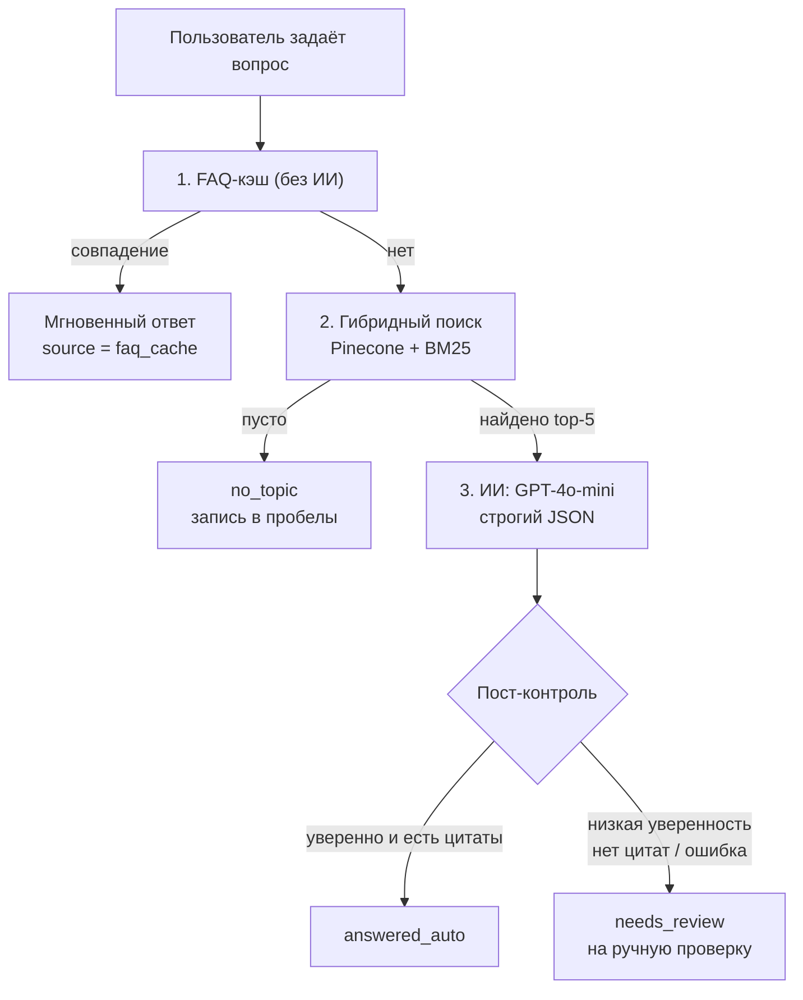
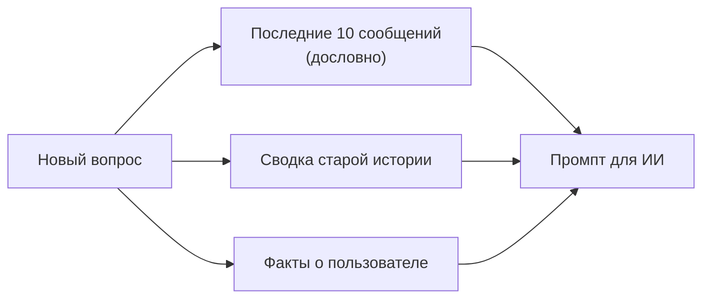

 <p align="center">
  <a href="https://github.com/igormikt/team-codex">
    
  </a>
</p>


 # team-codex

**База знаний команды с ИИ.** Сотрудник задаёт вопрос по внутренним регламентам — система находит ответ, показывает цитату из документа или честно говорит «информации нет». Ничего не выдумывает: каждый ответ проходит контроль качества, пишется в аудит, а сомнительные случаи уходят на ручную проверку.


> **Зачем это нужно.** Знания компании разбросаны по десяткам регламентов. Новый сотрудник ищет ответ вручную ~15 минут и дёргает наставника. team-codex отвечает за ~1 минуту, с точной цитатой, а если темы в базе нет — не придумывает, а фиксирует пробел.

---

## Содержание

- [Что умеет](#что-умеет)
- [Как это работает](#как-это-работает)
- [Поиск пользователем: что происходит после вопроса](#поиск-пользователем-что-происходит-после-вопроса)
- [Память диалога](#память-диалога)
- [Экраны системы](#экраны-системы)
- [Админка FAQ](#админка-faq)
- [Ручная проверка и экспорт](#ручная-проверка-и-экспорт)
- [Демонстрация (видео)](#демонстрация-видео)
- [Быстрый старт](#быстрый-старт)
- [Переменные окружения](#переменные-окружения)
- [API](#api)
- [Примеры запросов](#примеры-запросов)
- [Тесты и eval-набор](#тесты-и-eval-набор)
- [Структура проекта](#структура-проекта)
- [Тестовые данные](#тестовые-данные)
- [Безопасность](#безопасность)
- [Лицензия](#лицензия)

---

## Что умеет

| Возможность | Описание |
|---|---|
| **FAQ без ИИ** | Готовые «вопрос → ответ» отвечают мгновенно и бесплатно, без обращения к модели |
| **Умный поиск** | Гибрид: смысловой поиск (Pinecone) + поиск по точным словам (BM25) |
| **Ответы с цитатой** | ИИ отвечает строго по найденным фрагментам документов и приводит цитату |
| **Честное «не знаю»** | Если темы нет — статус `no_topic` и запись в список пробелов |
| **Память диалога** | Понимает уточняющие вопросы, помнит контекст и факты о пользователе |
| **Контроль качества** | Неуверенные ответы уходят на ручную проверку, всё пишется в аудит |
| **Eval-набор** | 55 тестовых вопросов для проверки качества ответов одной командой |

**Стек:** Python 3.11 · FastAPI · Pydantic v2 · SQLAlchemy · SQLite (локально) / PostgreSQL (план) · Pinecone · rank-bm25 · OpenAI GPT-4o-mini через ProxyAPI · Jinja2 + Pico CSS · Docker.

---

## Как это работает

Один вопрос проходит через короткий каскад — от самого дешёвого к самому умному:



Три исхода ответа:

| Статус | Что значит |
|---|---|
| `answered_auto` | Ответ найден, уверенность ≥ 0.75, есть цитата |
| `needs_review` | Система не уверена — ответ проверяет человек |
| `no_topic` | В базе нет такой темы — честный отказ, без выдумок |

---

## Поиск пользователем: что происходит после вопроса

Пользователь открывает экран **«Спросить ИИ»**, вводит вопрос и нажимает кнопку. Дальше всё происходит автоматически:

1. **Браузер запоминает пользователя.** При первом визите генерируется случайный номер диалога (`session_id`) и хранится в браузере. По нему система узнаёт, что вопросы идут от одного человека.

2. **Шаг 1 — FAQ-кэш (без ИИ).** Вопрос сверяется с таблицей частых вопросов `faq_entries`:
   - сначала ищется точное совпадение вопроса;
   - если нет — нечёткий поиск по ключевым словам (достаточно 2 общих слов).

   Нашли — ответ отдаётся **мгновенно**, ИИ не вызывается, токены не тратятся.

3. **Шаг 2 — гибридный поиск.** Если в FAQ ничего нет, вопрос превращается в вектор (эмбеддинг) и ищется сразу двумя способами:
   - **по смыслу** — в векторной базе Pinecone;
   - **по точным словам** — BM25 (важно для терминов вроде «ЕО», «СИЗ», номеров регламентов).

   Результаты объединяются: оценки обоих методов приводятся к одной шкале, а фрагменту, найденному сразу двумя способами, даётся бонус. Берётся топ-5 фрагментов.
   Ничего не нашлось — статус `no_topic` и запись в список пробелов.

4. **Шаг 3 — ответ ИИ.** Найденные фрагменты, память диалога и вопрос уходят в GPT-4o-mini. Модель обязана отвечать **только по этим фрагментам**, приводить цитату и возвращать строгий JSON.

5. **Контроль качества.** Прежде чем показать ответ, система проверяет: если уверенность низкая, цитат нет или модель ошиблась — ответ помечается `needs_review` и уходит в очередь ручной проверки на экране «Аудит». Владелец базы знаний разбирает очередь кнопками «Принять»/«Отклонить» (с комментарием): принятие возвращает статус `answered_auto`, отклонение — `rejected`; действие фиксируется в журнале запусков.

6. **Что видит пользователь.** Статус, текст ответа, процент уверенности и список цитат с номером документа и фрагмента. Плюс раскрывающийся «сырой JSON» для полного доверия.

---

## Память диалога

Память нужна, чтобы система понимала уточняющие вопросы («а сколько это дней?») и не теряла контекст в длинных диалогах. Работает в три слоя:



- **Свежая память.** Последние 10 сообщений сессии хранятся дословно. В ИИ уходят только последние 5 — чтобы не переполнять модель и не платить лишнее.
- **Сводка.** Когда сообщений становится больше 10, самые старые автоматически сжимаются в короткий пересказ (3–6 предложений) и дописываются в сводку сессии. Дословно они больше не хранятся.
- **Факты о пользователе.** Из старых сообщений извлекаются устойчивые факты (роль, подразделение, интересы) и складываются отдельным списком без повторов.

> **Важно:** память — это только контекст. Факты для ответа берутся исключительно из документов базы с цитатами, память поиск не подменяет.

---

## Экраны системы

| Адрес | Экран | Что там |
|---|---|---|
| `/` | **Документы** | Загрузка регламентов и витрина: список, темы, число фрагментов, кнопки «Редактировать» и «Удалить» |
| `/ask` | **Спросить ИИ** | Поле вопроса, ответ со статусом, уверенностью и цитатами |
| `/audit` | **Аудит** | Очередь ручной проверки с кнопками «Принять»/«Отклонить», журнал запусков, пробелы в знаниях и экспорт (JSON/CSV) |
| `/admin/faq` | **Админка FAQ** | Управление базой частых вопросов и ответов |
| `/docs` | **Swagger** | Все API-методы, можно тестировать прямо в браузере |

---

## Админка FAQ

База частых вопросов живёт в таблице `faq_entries`. Это первый и самый быстрый уровень поиска — работает без ИИ, поэтому её полезно пополнять типовыми вопросами.

Откройте **`http://127.0.0.1:8000/admin/faq`** (или пункт меню **FAQ**). Там можно:

- **Добавить** запись: вопрос, ответ, тема, ключевые слова, статус;
- **Редактировать** любую запись;
- **Включить / отключить** запись (`is_active`) — отключённые не участвуют в поиске;
- **Удалить** — это мягкое удаление (`is_active = false`), запись остаётся в базе и её можно вернуть.

По умолчанию запись отдаёт статус `answered_auto`. Если у записи задан `status = needs_review`, ответ из FAQ сразу уходит на ручную проверку (с причиной `review_reason`) — так можно заранее пометить заведомо неоднозначные вопросы.

Наполнить базу более 50 готовыми вопросами из регламентов (Кадры, Склад, ТОИР) и 5 вопросами на ручную проверку (`needs_review`):

```powershell
python scripts/seed_faq.py
```

Те же действия доступны через API `GET/POST/PUT/DELETE /faq/`.

---

## Ручная проверка и экспорт

Когда ответ уходит на ручную проверку (`needs_review`), он попадает в очередь на экране **`/audit`**. Там же доступны действия и выгрузки.

### Разбор очереди

В блоке «Записи, требующие проверки» у каждой записи две кнопки:

- **Принять** — снимает флаг `needs_review`, статус становится `answered_auto`;
- **Отклонить** — снимает флаг, статус становится `rejected`.

Обе кнопки спрашивают комментарий (можно оставить пустым). Комментарий и время проверки сохраняются в полях `review_note` / `reviewed_at`, а само решение пишется в журнал запусков (`audit_runs`, действие `review_answer`).

То же через API:

```bash
curl.exe -X POST http://127.0.0.1:8000/audit/answers/5/review -H "Content-Type: application/json" -d "{\"action\":\"approve\",\"note\":\"ответ подтверждён регламентом\"}"
```

`action` — только `approve` или `reject` (иначе `422`), несуществующий id — `404`.

> Записи не удаляются — они остаются в таблице `answers`, просто исчезают из очереди. Чтобы «вернуть» запись в очередь, поменяйте `needs_review` в базе вручную.

### Экспорт (JSON / CSV)

`GET /audit/export/{dataset}` отдаёт файлом (`Content-Disposition: attachment`) с пятью наборами данных:

| dataset | Что выгружается |
|---|---|
| `runs` | Журнал запусков (`audit_runs`) |
| `gaps` | Пробелы в знаниях (`knowledge_gaps`) |
| `answers` | Ответы системы, включая поля ручной проверки |
| `documents` | Документы с количеством фрагментов и полным текстом |
| `faq` | Записи FAQ со статусом и активностью |

Формат — `?format=json` или `?format=csv` (по умолчанию `json`). CSV кодируется с BOM, чтобы кириллица корректно открывалась в Excel. Кнопки выгрузки есть прямо на экране `/audit`.

```bash
curl.exe "http://127.0.0.1:8000/audit/export/answers?format=csv" --output answers.csv
curl.exe "http://127.0.0.1:8000/audit/export/documents?format=json" --output documents.json
```

Ошибки: `404` — неизвестный dataset или нет данных, `400` — неверный формат. Сам экспорт тоже фиксируется в `audit_runs` (действие `export`).

---

## Демонстрация (видео)

Демо (2–4 мин): https://<ссылка-после-загрузки>

Формат: запись экрана, 10 сцен, хронометраж ~3:15; возможны короткие версии на 2:00 и 60 сек.

Сценарий: загрузка регламента → ответ с цитатой → типовой вопрос из FAQ → «темы нет» → вопрос про пароль (ручная проверка) → разбор очереди на экране аудита («Принять»/«Отклонить») → экспорт `answers.csv` → `make eval`.

---

## Быстрый старт

**Windows 11, PowerShell.**

### 1. Однокомандный bootstrap

```powershell
cd M:\Projects\team-codex
.\bootstrap.ps1
```

Скрипт создаст `.venv`, установит зависимости, скопирует `.env.example` в `.env` и подготовит базу SQLite.

### 2. Добавьте ключи API

```powershell
notepad .env
```

Заполните две строки:

```
OPENAI_API_KEY=sk-ваш-ключ-proxyapi
PINECONE_API_KEY=ваш-ключ-pinecone
```

### 3. Запустите сервер

```powershell
.\.venv\Scripts\Activate.ps1
uvicorn app.main:app --reload
```

Сервер готов, когда в консоли появится `Application startup complete.`

### 4. Откройте в браузере

- Веб-панель — http://127.0.0.1:8000
- Swagger — http://127.0.0.1:8000/docs
- Health — http://127.0.0.1:8000/health

<details>
<summary><b>Ручная установка (без bootstrap) и Docker</b></summary>

```powershell
py -3.11 -m venv .venv
.\.venv\Scripts\Activate.ps1
pip install -r requirements.txt
# опционально для разработки: тесты (pytest) и отладка API (httpie)
pip install -r requirements-dev.txt
copy .env.example .env
# откройте .env и впишите ключи
uvicorn app.main:app --reload
```

Docker:

```bash
docker compose up --build
```

Или пошагово:

```bash
docker build -t team-codex:latest .
docker run -d --name team-codex -p 8000:8000 --env-file .env team-codex:latest
docker rm -f team-codex          # остановить и удалить контейнер
```

Файл `.dockerignore` исключает из контекста сборки `.venv`, `.env` и служебные файлы. Поэтому в образ не попадают ни виртуальное окружение, ни ключи — работает только `--env-file .env` во время запуска. Проверено: образ ~545 МБ, `/app/.env` внутри отсутствует, все экраны и `/health` отвечают `200`.

**Уязвимости.** Базовый образ обновлён до свежего `python:3.11-slim` (Debian 13) с `apt-get upgrade`, `pip` и `setuptools` подняты до актуальных версий, а пакеты с известными CVE в `requirements.txt` обновлены. Dev-инструменты (`pytest`, `httpie`) вынесены в `requirements-dev.txt` и в образ не ставятся. Итог: `pip-audit` внутри контейнера отвечает «No known vulnerabilities found», обновляемых системных пакетов нет.

</details>

---

## Переменные окружения

| Переменная | Назначение | Пример |
|---|---|---|
| `OPENAI_API_KEY` | Ключ API ProxyAPI | `sk-...` |
| `OPENAI_BASE_URL` | Адрес провайдера модели | `https://openai.api.proxyapi.ru/v1` |
| `OPENAI_MODEL` | Модель ИИ | `openai/gpt-4o-mini` |
| `OPENAI_EMBEDDING_MODEL` | Модель эмбеддингов | `text-embedding-3-small` |
| `EMBEDDING_DIMENSION` | Размерность вектора | `1536` |
| `LLM_TEMPERATURE` | «Температура» ИИ (0 — строго) | `0.1` |
| `LLM_TIMEOUT_SECONDS` | Таймаут запроса к ИИ | `60` |
| `PINECONE_API_KEY` | Ключ Pinecone | `pcsk_...` |
| `PINECONE_INDEX_NAME` | Имя векторного индекса | `test08` |
| `DATABASE_URL` | Подключение к БД | `sqlite:///./team_codex.db` |
| `SEARCH_MODE` | Задел на будущее (сейчас всегда работает гибридный каскад) | `vector` |
| `MEMORY_MAX_MESSAGES` | Сколько сообщений хранить дословно | `10` |
| `MEMORY_LLM_MESSAGES` | Сколько последних сообщений отправлять в ИИ | `5` |
| `APP_NAME` | Имя приложения | `team-codex` |
| `DEBUG` | Режим отладки | `true` |
| `SECRET_KEY` | Секрет приложения | случайная строка |

Полный шаблон — в `.env.example` (без реальных секретов).

> **Подсказка для Windows.** В PowerShell команда `curl` — это псевдоним `Invoke-WebRequest`. Используйте `curl.exe` либо команды `Invoke-RestMethod` из примеров ниже.

---

## API

| Метод | Путь | Назначение |
|---|---|---|
| `POST` | `/documents/` | Создать документ и проиндексировать его в Pinecone |
| `POST` | `/documents/upload` | Загрузить файл `.txt` / `.md` |
| `GET` | `/documents/` | Витрина документов |
| `PUT` | `/documents/{id}` | Изменить название или тему |
| `DELETE` | `/documents/{id}` | Удалить документ и его векторы |
| `POST` | `/ask/` | Задать вопрос (каскад FAQ → поиск → ИИ) |
| `GET` | `/ask/needs-review` | Очередь ручной проверки |
| `GET` | `/faq/` | Список записей FAQ |
| `POST` | `/faq/` | Добавить запись FAQ |
| `PUT` | `/faq/{id}` | Изменить запись FAQ |
| `DELETE` | `/faq/{id}` | Отключить запись FAQ (мягкое удаление) |
| `GET` | `/audit/runs` | Журнал запусков |
| `GET` | `/audit/gaps` | Пробелы в знаниях |
| `POST` | `/audit/answers/{id}/review` | Принять/отклонить ответ из очереди ручной проверки |
| `GET` | `/audit/export/{dataset}?format=json\|csv` | Выгрузка данных (datasets: `runs`, `gaps`, `answers`, `documents`, `faq`) |
| `GET` | `/health` | Проверка работоспособности |

Веб-страницы: `/`, `/ask`, `/audit`, `/admin/faq`. Документация: `/docs`.

---

## Примеры запросов

### Загрузить документ

```bash
curl.exe -X POST "http://127.0.0.1:8000/documents/" ^
  -F "title=Регламент отпусков" ^
  -F "topic=Отпуска" ^
  -F "content=Ежегодный отпуск — 28 календарных дней. Перенос отпуска требует уведомления руководителя не позднее чем за 14 дней."
```

Ответ:

```json
{"id":1,"title":"Регламент отпусков","topic":"Отпуска","chunks_count":1,"created_at":"..."}
```

### Загрузить файл

```bash
curl.exe -X POST "http://127.0.0.1:8000/documents/upload" ^
  -F "title=Охрана труда" ^
  -F "topic=Охрана труда" ^
  -F "file=@tests_data/ohrana_truda.txt"
```

### Задать вопрос

```bash
curl.exe -X POST "http://127.0.0.1:8000/ask/" ^
  -H "Content-Type: application/json" ^
  -d "{\"question\":\"За сколько дней нужно уведомить о переносе отпуска?\",\"session_id\":\"demo-1\"}"
```

Ответ:

```json
{
  "id": 1,
  "question": "За сколько дней нужно уведомить о переносе отпуска?",
  "result": {
    "found": true,
    "topic": "Отпуска",
    "answer": "О переносе отпуска необходимо уведомить руководителя не позднее чем за 14 дней.",
    "citations": [{"document_id":1,"chunk_id":1,"quote":"Перенос отпуска требует уведомления руководителя не позднее чем за 14 дней."}],
    "confidence": 0.92,
    "status": "answered_auto",
    "needs_review": false,
    "review_reason": null,
    "source": "faq_cache"
  },
  "created_at": "..."
}
```

Поле `source` подсказывает, откуда пришёл ответ: `faq_cache`, `hybrid_search` или `hybrid_search+llm`.

### Служебные запросы

```bash
curl.exe http://127.0.0.1:8000/documents/        # витрина
curl.exe http://127.0.0.1:8000/audit/runs        # журнал аудита
curl.exe http://127.0.0.1:8000/ask/needs-review  # очередь ручной проверки
curl.exe http://127.0.0.1:8000/audit/gaps        # пробелы в знаниях
curl.exe -X DELETE http://127.0.0.1:8000/documents/1

curl.exe "http://127.0.0.1:8000/audit/export/answers?format=csv" --output answers.csv  # экспорт очереди проверки
curl.exe "http://127.0.0.1:8000/audit/export/runs?format=json" --output runs.json    # экспорт журнала запусков
```

> На PowerShell русский текст в `-d` может «поехать» из-за кодировки. Надёжнее `Invoke-RestMethod` с явной UTF-8 (см. примеры ниже).

---

## Тесты и eval-набор

В проекте есть набор из **55 вопросов** с ожидаемым статусом и эталонной цитатой — это регрессионный тест качества. Он отправляет вопросы на работающий сервер и сравнивает результат.

```powershell
# сервер должен быть запущен
python run_eval.py
# или
make eval
```

Отчёт выводит «пройдено / провалено» по каждому вопросу и возвращает ненулевой код при провале — готово к подключению в CI/CD.

`pytest` и `httpie` лежат отдельно, в `requirements-dev.txt`: в Docker-образ они не ставятся, чтобы рантайм-контейнер не тянул пакеты с известными CVE.

<details>
<summary><b>Ручная проверка ключевых сценариев</b></summary>

Успешный ответ (PowerShell, UTF-8):

```powershell
$body = @{ question = "За сколько дней нужно уведомить о переносе отпуска?"; session_id = "check-1" } | ConvertTo-Json
$r = Invoke-RestMethod -Uri "http://127.0.0.1:8000/ask/" -Method Post -ContentType "application/json; charset=utf-8" -Body ([System.Text.Encoding]::UTF8.GetBytes($body))
$r.result
```

Ожидаемо: `status = "answered_auto"`, есть цитаты, `confidence >= 0.75`.

Честное «не знаю»:

```powershell
$body = @{ question = "Как получить ипотеку?"; session_id = "check-2" } | ConvertTo-Json
$r = Invoke-RestMethod -Uri "http://127.0.0.1:8000/ask/" -Method Post -ContentType "application/json; charset=utf-8" -Body ([System.Text.Encoding]::UTF8.GetBytes($body))
$r.result
```

Ожидаемо: `status = "no_topic"`, `answer = "По этой теме пока нет информации в базе знаний."`

Ручная проверка (нет данных про пароль):

```powershell
$body = @{ question = "Какой пароль от корпоративного Wi-Fi?"; session_id = "check-3" } | ConvertTo-Json
$r = Invoke-RestMethod -Uri "http://127.0.0.1:8000/ask/" -Method Post -ContentType "application/json; charset=utf-8" -Body ([System.Text.Encoding]::UTF8.GetBytes($body))
$r.result.status; $r.result.needs_review; $r.result.review_reason
```

Ожидаемо: `needs_review`, `True`, `low_confidence`.

Разбор очереди (кнопки «Принять»/«Отклонить» на `/audit`, либо API):

```powershell
# id из очереди GET /ask/needs-review
Invoke-RestMethod -Uri "http://127.0.0.1:8000/audit/answers/1/review" -Method Post -ContentType "application/json" -Body '{"action":"approve","note":"ответ подтверждён"}'
```

Ожидаемо: запись исчезает из очереди, в `GET /audit/runs` появляется действие `review_answer`.

Экспорт:

```powershell
curl.exe "http://127.0.0.1:8000/audit/export/answers?format=csv" --output answers.csv
curl.exe "http://127.0.0.1:8000/audit/export/runs?format=json" --output runs.json
```

Ожидаемо: скачиваются файлы, CSV открывается в Excel с корректной кириллицей, в `audit_runs` появляется действие `export`.

</details>

Команды Makefile: `make install`, `make run`, `make seed-faq`, `make eval`.

---

## Структура проекта

```
team-codex/
├── app/
│   ├── main.py              Точка входа FastAPI + веб-страницы
│   ├── config.py            Настройки (pydantic-settings)
│   ├── database.py          Движок SQLAlchemy и апгрейды схемы
│   ├── models.py            Таблицы базы данных
│   ├── schemas.py           Pydantic-схемы (строгий JSON)
│   ├── pinecone_service.py  Векторный поиск + гибрид (BM25)
│   ├── faq_service.py       Поиск по FAQ-кэшу
│   ├── memory_service.py    Память: сводка истории и факты
│   ├── llm_service.py       Вызовы ИИ и системный промпт
│   ├── audit.py             Запись действий в audit_runs
│   ├── routers/             documents, ask, audit, faq
│   ├── templates/           Экраны панели (Jinja2)
│   └── static/styles.css
├── tests_data/              Тестовые данные и eval-набор
├── scripts/seed_faq.py      Наполнение FAQ-кэша
├── run_eval.py              Запуск eval-набора
├── bootstrap.ps1            Установщик для Windows
├── requirements.txt
├── requirements-dev.txt     Тесты и отладка (не попадает в Docker-образ)
├── .env.example             Шаблон переменных (без секретов)
├── Dockerfile / docker-compose.yml
├── .dockerignore           Не тащит .venv и .env в Docker-образ
├── Makefile
└── README.md
```

---

## Тестовые данные

В папке `tests_data/`:

- `kb_documents.jsonl` — 5 коротких документов для быстрой загрузки;
- `kb_questions.jsonl` — 55 вопросов для eval-набора (47 `answered_auto`, 3 `no_topic`, 5 `needs_review`);
- 7 полных регламентов ООО «ПромТехно»: охрана труда, СИЗ, сдача-приёмка смен, брак, кадры, складская логистика, ТОиР.

Быстрая загрузка документов пачкой (PowerShell):

```powershell
Get-Content tests_data\kb_documents.jsonl -Encoding UTF8 | ForEach-Object {
  $d = $_ | ConvertFrom-Json
  $body = @{ title = $d.title; topic = $d.topic; content = $d.content }
  Invoke-RestMethod -Uri "http://127.0.0.1:8000/documents/" -Method Post -Body $body
}
```

---

## Безопасность

- `.env` в `.gitignore` — секреты не попадают в репозиторий.
- В репозитории лежит только `.env.example` с заглушками.
- При подозрении на утечку — смените ключи.

---

## Лицензия

MIT
